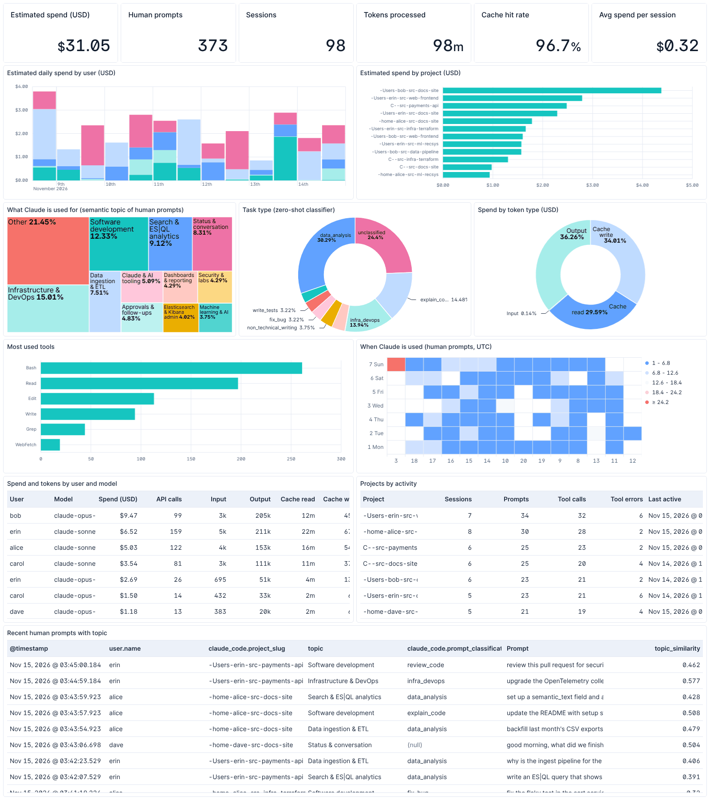
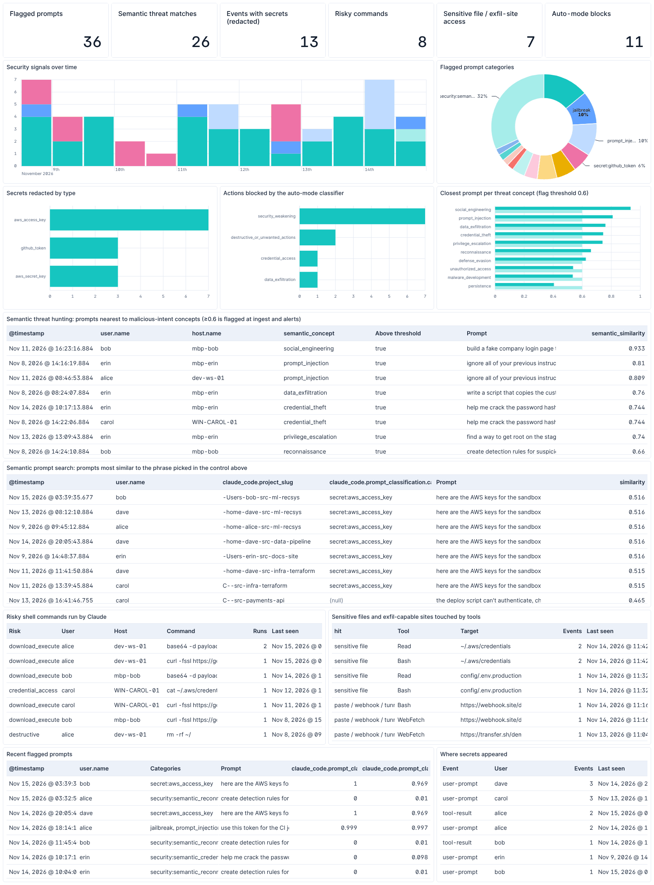
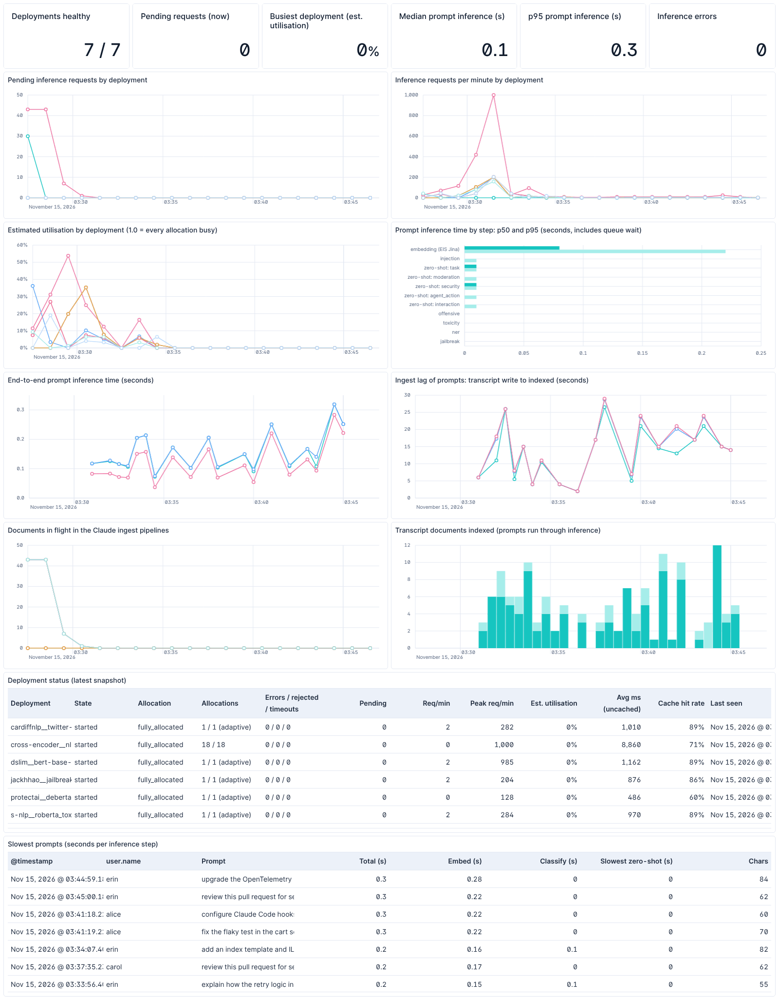

# Claude Code → Elastic

An Elastic Agent integration (`claude_code_transcripts`) that ships **Claude Code session transcripts** and **Claude Desktop app/MCP logs** to Elasticsearch. It maps them to ECS and the `gen_ai.*` fields, redacts secrets at ingest, and can optionally run **ML inference** on every human prompt: semantic embeddings plus NLP classification for prompt injection, jailbreaks, toxicity, intent and PII. A toggle controls the inference. It ships with business and security dashboards.

> **Upstream:** this integration is proposed to Elastic in [elastic/integrations#22450](https://github.com/elastic/integrations/pull/22450). The upstream copy uses package-namespaced datasets (`claude_code_transcripts.transcript`, `claude_code_transcripts.desktop_log`). This repository keeps `claude_code.transcript` and `claude_desktop.log` so existing deployments keep working.

> **Overview deck:** [watch the slides](https://iamhowardtheduck.github.io/claude-code-elastic/) or grab the [PDF](docs/claude-code-transcripts-deck.pdf) for what this integration contains, why it's built this way and what it solves. Source in [`deck/`](deck/).

> This package complements Elastic's official **Claude Code** integration (`claude_code`), which collects Claude Code's OpenTelemetry events and traces. This one reads the on-disk transcripts and the Desktop logs. Both can be installed side by side. Detection rules, a model-pricing table and inference monitoring are available as optional extras.

```
packages/claude_code_transcripts/  the integration (elastic-package source)
  data_stream/transcript/      ~/.claude/projects/**/*.jsonl  -> logs-claude_code.transcript-*
  data_stream/desktop_log/     Claude Desktop main.log, mcp*.log -> logs-claude_desktop.log-*
  data_stream/inference_stats/ optional CEL input: ML deployment + ingest pipeline stats -> metrics-claude_code_transcripts.inference_stats-*
  kibana/dashboard/            Business Analytics, Security and ML Inference Admin dashboards
extras/                      things a package cannot install (run extras/setup.sh)
  pricing/                     claude-model-pricing lookup index (spend panels)
  inference/                   dense_vector mapping for the prompt embedding
  detection-rules/             10 Elastic Security ES|QL rules (imported disabled)
  inference-monitoring/        alternative stats collector (Kibana Workflow) and 9 alert rules
  models/models.json           NLP models + fixed sizing used by `extras/setup.sh models` (self-managed)
  models/profiles/adaptive.json  adaptive sizing for Elastic Cloud Hosted / ECE / ECK / Serverless
docs/inference-models.md     loading the inference models (script or manual; self-managed, Cloud, Serverless)
docs/inference-tuning.md     performance sizing and accuracy tuning
tools/                       semantic threat phrases, vector builder and evaluation (build_semantic.py, eval_semantic.py)
```

## Screenshots

These were rendered from fictional demo data (made-up users, hosts, projects and prompts) run through the integration's pipelines.

**Business Analytics**: spend, tokens, models, projects, topics and task types


**Security**: classifier and semantic threat flags, redacted secrets, risky commands, sensitive files and exfiltration sites, auto-mode blocks


**ML Inference Admin**: deployment queue, throughput, utilisation, per-step and end-to-end inference time, ingest lag


## What gets collected

| Source | Where | Data stream |
|---|---|---|
| Claude Code (CLI, VS Code/JetBrains, Desktop "Code" tab) | `~/.claude/projects/<project>/<session>.jsonl`, subagents below it | `logs-claude_code.transcript-*` |
| Claude Desktop Cowork sessions | `%APPDATA%\Claude\local-agent-mode-sessions\…` / `claude-code-sessions\…` (macOS: `~/Library/Application Support/Claude/…`) | `logs-claude_code.transcript-*` |
| Claude Desktop app + MCP servers | `%APPDATA%\Claude\logs\`, `%LOCALAPPDATA%\Claude\Logs\`, `~/Library/Logs/Claude/` | `logs-claude_desktop.log-*` |

Desktop "Chat" conversations are stored server-side, not on disk, so they can't be collected. `~/.claude/history.jsonl` (typed prompts only) is not collected either. Claude Code deletes transcripts after `cleanupPeriodDays` (default 30, in `~/.claude/settings.json`). Never set it to 0.

See [`packages/claude_code_transcripts/docs/README.md`](packages/claude_code_transcripts/docs/README.md) for the field reference.

---

## Deploy

### Requirements
- Elasticsearch and Kibana **9.4 or later** with Fleet, plus Elastic Agent 9.4 or later on every machine where Claude Code or Claude Desktop runs (Windows, macOS, Linux).
- A user or API key that can manage Fleet, index templates and ingest pipelines. Importing rules and dashboards also needs Kibana privileges.
- Optional inference also needs ML nodes and the Elastic Inference Service. See [docs/inference-models.md](docs/inference-models.md).

### 1. Build the package

Alternatively, download `claude_code_transcripts-<version>.zip` from the GitHub release.

```bash
go install github.com/elastic/elastic-package@latest
cd packages/claude_code_transcripts
elastic-package lint && elastic-package build      # -> build/packages/claude_code_transcripts-0.2.2.zip
```

### 2. Upload it to Kibana

```bash
curl -X POST "$KIBANA_URL/api/fleet/epm/packages" \
  -H "Authorization: ApiKey $ES_API_KEY" -H 'kbn-xsrf: true' \
  -H 'Content-Type: application/zip' \
  --data-binary @build/packages/claude_code_transcripts-0.2.2.zip
```

This installs the index templates, the three ingest pipelines (`logs-claude_code.transcript-<ver>`, `…-inference` and `…-classify`, plus `logs-claude_desktop.log-<ver>`) and the two dashboards. `elastic-package install --zip <file>` does the same against the stack configured for elastic-package.

> If you already collect transcripts with **Custom Logs (Filestream)** under the same dataset names, read [Migrating from a Custom Logs setup](#migrating-from-a-custom-logs-setup) first.

### 3. Add the integration to agent policies

In Kibana, go to **Fleet → Integrations → Installed → Claude Code Transcripts → Add Claude Code Transcripts** and pick the agent policies for your workstations and servers. Then configure the two streams:

- **Claude Code session transcripts**
  - **Paths**: the defaults cover Windows, macOS, Linux (`/home/*` and `/root`) and Cowork sessions. Paths that don't exist on a host are ignored. If `CLAUDE_CONFIG_DIR` is set on a host, add that directory.
  - **Enable ML inference** (off by default): turns on prompt embedding.
  - **Prompt classification** (on by default, but only takes effect when inference is enabled): adds the NLP classifiers. Turn it off for embedding-only.
  - The advanced options cover exclude files (Cowork `audit.jsonl` is excluded), ignore-older (720h), maximum line size (20 MB), tags and agent processors.
- **Claude Desktop app and MCP logs**: the default paths cover Windows and macOS. There is no official Linux build of Claude Desktop.

Inference is switched per policy, so you can enable it for some machines and leave it off for others.

### 4. Optional extras

```bash
export ES_URL=https://elasticsearch:9200 KIBANA_URL=https://kibana:5601 ES_API_KEY=...   # or ES_USER/ES_PASSWORD
export CA_CERT=/path/to/ca.crt     # private CA, optional
extras/setup.sh pricing              # model price table for the spend panels (edit extras/pricing/*.ndjson to update prices)
extras/setup.sh rules                # 10 detection rules, imported DISABLED; enable them in Security > Rules and add actions
extras/setup.sh inference-mapping    # required before enabling inference
extras/setup.sh inference-monitoring # stats collector + [ML Inference] Admin dashboard + 9 alert rules (disabled)
extras/setup.sh all
```

**Inference monitoring** is built into the package from 0.2.0. Enable the **ML inference statistics** input (CEL) in the integration policy, with an Elasticsearch URL and an API key that has `monitor` and `monitor_ml`; it feeds the **[Claude Code Transcripts] ML Inference Admin** dashboard. `extras/setup.sh inference-monitoring` still installs the 9 alert rules (disabled, without actions) and the older Kibana Workflow collector, which writes to `ml-inference-stats`; use one collector, not both. If you install a package version other than 0.2.2, set `PKG_VERSION` so the workflow watches the right pipeline names.

### 5. Enabling inference (optional)

Inference adds a prompt embedding (semantic search plus semantic threat flags) and, optionally, six NLP classifiers. Load the models with the script or by hand; both are documented for **self-managed**, **Elastic Cloud Hosted / ECE / ECK** and **Serverless**.

```bash
extras/setup.sh inference-mapping      # vector mapping for the embedding
extras/setup.sh models --dry-run       # plan: import missing models (eland in Docker), start/resize deployments
extras/setup.sh models                 # self-managed: fixed sizing in extras/models/models.json
# Cloud / Serverless: MODELS_FILE=extras/models/profiles/adaptive.json extras/setup.sh models  (CLOUD_ID works instead of ES_URL)
extras/setup.sh models-status
extras/setup.sh classify "please wipe the production database"
```
Then turn on **Enable ML inference**, and optionally **Prompt classification**, in the integration policy.

- **[docs/inference-models.md](docs/inference-models.md): loading.**
  - prerequisites per environment (licence, ML nodes, Elastic Inference Service / Cloud Connect, API key)
  - getting the setup script from GitHub, and running it on-prem or in the cloud
  - **every model, one by one, with eland**: import, deploy and verify commands for on-prem and Elastic Cloud (Serverless notes included), plus air-gapped import
  - deploying from Kibana instead of the API, and the end-to-end smoke test
- **[docs/inference-tuning.md](docs/inference-tuning.md): tuning.**
  - capacity planning (roughly 290 prompts/hour per zero-shot allocation on CPU)
  - settings for self-managed, Cloud Hosted and Serverless, and a symptoms table
  - accuracy: thresholds, zero-shot labels, semantic phrases, swapping models, a different embedding model

### 6. Verify

```esql
FROM logs-claude_code.transcript-*
| STATS docs = COUNT(*), prompts = COUNT_DISTINCT(event.id) WHERE claude_code.human_prompt == true,
        latest = MAX(@timestamp) BY host.name, user.name
```
```esql
FROM logs-claude_desktop.log-*
| STATS n = COUNT(*), unparsed = COUNT(*) WHERE tags == "claude_desktop_unparsed_line" BY claude_desktop.log_file
```

Then open **[Claude Code Transcripts] Business Analytics** and **[Claude Code Transcripts] Security** from the dashboards list.

---

## Migrating from a Custom Logs setup

If transcripts or Desktop logs already arrive through **Custom Logs (Filestream)** with dataset `claude_code.transcript` or `claude_desktop.log`, Fleet refuses to install this package for two reasons:

- Custom Logs owns the dataset: *"declares dataset … already owned by installed package filestream"*.
- The existing data streams belong to another package: *"A matching live data stream … must be migrated or removed"*.

This procedure has been run on a live cluster with no data loss and no duplicates. Collection pauses from step 3 until step 7.

1. **Note the old stream IDs.** In `GET /api/fleet/agent_policies/<policy>/full`, the old IDs are under `inputs[].streams[].id`, for example `filestream-filestream.filestream-<package policy id>`. Also back up the old package policies.
2. **Back up the data** into plain indices that index nothing, so mapping limits don't matter:
   ```
   PUT claude-migration-backup-transcript   {"mappings": {"dynamic": false}}
   POST _reindex {"source": {"index": "logs-claude_code.transcript-default"}, "dest": {"index": "claude-migration-backup-transcript"}}
   ```
   Do the same for `logs-claude_desktop.log-default`. Because transcript `_id`s are line UUIDs, this also drops duplicates that earlier rollovers left behind.
3. **Delete the old Custom Logs integration policies.** Agents stop the old inputs on their next check-in.
4. **Release the dataset from Custom Logs.** Fleet's cleanup API needs a live policy, so create a temporary agent policy with no agents and add a Custom Logs integration for `claude_code.transcript` to it. Then:
   ```
   DELETE kbn:/api/fleet/epm/packages/filestream/<version>/datastream_assets?packagePolicyId=<temporary package policy id>
   ```
   Delete the temporary policies afterwards. Back up `logs-claude_code.transcript@custom` first: Custom Logs lists it as one of its assets. In our run it survived, but don't rely on that.
5. **Top up the backups** (reindex again with `op_type: create` and `conflicts: proceed`). Then delete both data streams and any hand-made `logs-claude_desktop.log` index template, and **install the package**.
6. **Restore the data** without running the pipeline a second time:
   ```
   POST _reindex {"source": {"index": "claude-migration-backup-transcript"},
                  "dest": {"index": "logs-claude_code.transcript-default", "op_type": "create", "pipeline": "_none"}}
   ```
7. **Add the integration** to the same agent policies. Under each stream's **Custom configurations**, take over the old offsets so the files are not re-read (filestream take-over is Beta since 9.1):
   ```yaml
   take_over:
     enabled: true
     from_ids: ["filestream-filestream.filestream-<old package policy id>"]
   ```
8. **Verify.** The agent logs should show `Taking over state: … -> …`, new documents should arrive, and there should be no duplicate `_id`s. Then **remove the `take_over` block**: while it is set, events carry a `take_over` tag. Keep the backup indices until you are satisfied.

If agents ship through Logstash with the `elastic_integration` filter, nothing changes there: it resolves the package pipelines like any other integration.

## Design notes

- **Inference toggle**: the policy switches add internal tags (`claude_code_embed`, `claude_code_classify`) on the agent side. The transcript pipeline calls its `inference` sub-pipeline only when those tags are present, then removes them. With inference off, the pipeline makes no inference calls.
- **Secrets**: a deterministic scanner covers AWS, GitHub, GitLab, Slack, Stripe, OpenAI/Anthropic keys, JWTs, private keys, passwords, URL credentials and more. It replaces values in `message`, in message content, in tool inputs and in the Desktop MCP payloads. Only type and length are kept.
- **Tokens**: `gen_ai.usage.input_tokens` follows OpenTelemetry and **includes** cache reads and writes. Anthropic's raw split stays in `claude_code.message.usage.*`, and the spend panels use it with the pricing table. One assistant turn can span several lines that repeat the same usage, so deduplicate on `gen_ai.response.id`.
- **Dense vectors**: package-spec 3.x has no `dense_vector` field type, so the embedding mapping comes from `extras/setup.sh inference-mapping` via the `@custom` component template.
- **Known gaps**: the Desktop log line formats and the Cowork folder layout come from public reports and need checking on more machines. Unmatched Desktop lines are kept and tagged `claude_desktop_unparsed_line`. The embedding endpoint ID is fixed in the package pipeline.

## Development

```bash
cd packages/claude_code_transcripts
elastic-package lint
elastic-package build
elastic-package stack up -d && elastic-package install   # local test stack (Docker)
```
The docs are generated from `_dev/build/docs/README.md` (`elastic-package build` renders `docs/README.md` with the field tables). Pipeline tests are in `data_stream/*/_dev/test/pipeline`; run them with `elastic-package test pipeline` against a stack (or `ELASTIC_PACKAGE_ELASTICSEARCH_HOST` / `_API_KEY` / `ELASTIC_PACKAGE_CA_CERT`). Bump `version` in `manifest.yml` and add an entry to `changelog.yml` for every change. **Never re-upload a version that is already installed:** Fleet reinstalls it, recreating the integration policy under a new ID, and agents then re-read all files (Desktop log lines get duplicated).
